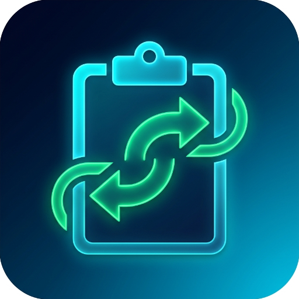

# LanClip Share — Área de Transferência & Arquivos na Rede Local (Android, macOS e Linux)

  

Aplicativo multiplataforma (**Android Nativo em Kotlin/Jetpack Compose**, **macOS `.dmg`** e **Linux `.flatpak`**) que funciona como uma **Área de Transferência (Clipboard) compartilhada e transferidor de arquivos de alta velocidade** entre dispositivos dentro da mesma rede Wi-Fi / LAN.

Projetado originalmente para integrar **Tablet Xiaomi ↔ Celular Motorola ↔ Mac ↔ Linux** sem depender de nuvem ou cabos.

---

## 📥 Instaladores Prontos (`releases/`)

| Plataforma | Arquivo | Descrição |
| :--- | :--- | :--- |
| **📱 Android (8.0 a 15+)** | [`releases/LanClipShare-v1.0.1.apk`](releases/LanClipShare-v1.0.1.apk) | APK assinado com suporte a Clipboard, Arquivos, Share Sheet, Quick Settings Tile e Extrator de APKs |
| **🍎 macOS** | [`releases/LanClipShare-macOS-v1.0.1.dmg`](releases/LanClipShare-macOS-v1.0.1.dmg) | Imagem de disco `.dmg` contendo `LanClipShare.app` com integração nativa `pbcopy`/`pbpaste` |
| **🐧 Linux** | [`releases/LanClipShare-Linux-v1.0.1.flatpak`](releases/LanClipShare-Linux-v1.0.1.flatpak) | Bundle Flatpak single-file (`com.lanclip.Share`) com suporte a Wayland (`wl-clipboard`) e X11 (`xclip`/`xsel`) |

---

## ✨ Principais Funcionalidades

1. **Área de Transferência Instantânea (Clipboard)**:
   - Textos recebidos entram automaticamente no `Ctrl+V` / `Cmd+V` / **"Colar"** do dispositivo de destino.
   - No Android 10+, inclui **Tile nas Configurações Rápidas ("Enviar Clipboard")** para enviar o texto copiado de qualquer tela com 1 toque.
2. **Envio de Todos os Tipos de Arquivos (Sem Limite de Tamanho)**:
   - Fotos, vídeos, planilhas (`.xlsx`, `.csv`, `.ods`), PDFs, arquivos compactados e documentos via streaming TCP direto em blocos de `64 KB` na velocidade máxima do Wi-Fi.
   - Integração nativa com o menu **"Compartilhar" (Share Sheet)** do Android.
3. **Extrator e Enviador de Aplicativos Inteiros (`.APK`)**:
   - Aba dedicada no app Android que lista todos os aplicativos instalados no aparelho e permite enviar o pacote `.apk` completo para outro dispositivo Android ou computador, com botão **"Instalar APK"** ao receber.
4. **Descoberta Híbrida na Rede Local**:
   - **Automática**: combina **UDP Broadcast** (porta `45454`) + **Android NSD / mDNS** (`_lanclip._tcp.`).
   - **Manual / QR Code**: pareamento instantâneo via leitura de **QR Code** (`lanclip://connect?...`) ou digitação manual do IP local.

---

## 📂 Estrutura do Repositório

- [`app/`](app/) — Código-fonte completo do aplicativo Android nativo (Kotlin + Jetpack Compose Material 3).
- [`desktop/`](desktop/) — Código-fonte da versão Desktop (`macOS` e `Linux`) e manifesto Flatpak (`com.lanclip.Share.yml`).
- [`releases/`](releases/) — Instaladores compilados (`.apk`, `.dmg` e `.flatpak`).
